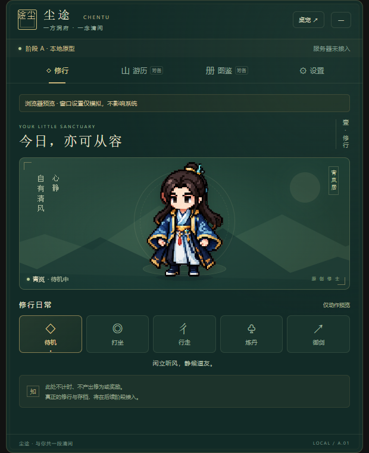

# 尘途修仙

《尘途修仙》是一款以洞府经营和放置成长为核心的修仙桌宠游戏。当前项目同时提供可直接游玩的浏览器版本、可安装 PWA、Windows Electron 桌宠客户端，以及正在建设中的 Fastify + PostgreSQL 服务端。

> 在线试玩：**[https://brzjhh.github.io/fr-moyu-xiuxian/](https://brzjhh.github.io/fr-moyu-xiuxian/)**

网页版本无需下载，打开即可开始修炼。当前网页存档保存在本机浏览器中，清理网站数据或更换设备不会自动同步，请定期使用设置页导出 JSON 存档。



## 当前版本

当前开发版本为 **v0.4.0**，已经形成一套可游玩的本地单人修仙循环：打坐获得修为、逐层突破、经营药田、炼制丹药、外出历练、管理行囊，并在网页或 Electron 桌宠中持续保存进度。

服务端已经具备邀请码注册、密码登录、Bearer 会话和云存档 API，但客户端账号界面与自动云同步尚未接入。因此，目前公开网页仍以浏览器本地存档为准，不应把服务端 API 视为已经开放的在线账号系统。

## 核心玩法

### 修炼与境界

- 进入打坐状态后每秒获得 1 点修为，切换到其他动作时暂停增长。
- 境界覆盖炼气一层至炼气十三层，并可消耗筑基丹突破至筑基初期。
- 突破会保留超过门槛的修为，不会清空溢出进度。
- 关闭游戏后会根据最后一次打坐状态结算离线收益，单次最多计算 8 小时。
- 修行页展示当前境界、修为进度、动作状态和最近修行纪要。

### 洞府与药田

- 洞府中有两块独立药田，可消耗下品灵石种植凝露草。
- 每块药田独立计时，成熟后由玩家手动收获。
- 药田属于被动生产，不占用角色正在进行的炼丹或历练任务。
- 离开页面或关闭客户端后，成熟时间仍按存档时间继续结算。

### 丹房

- 聚气丹：消耗凝露草和灵石炼制，服用后直接增加修为。
- 筑基丹：消耗凝露草、妖兽内丹和灵石炼制，是突破筑基初期的必要材料。
- 炼丹任务有独立倒计时，完成后需要领取产物。
- 炼丹与历练互斥，角色同一时间只能执行一项主动任务。

### 历练

- 当前开放青石岭“稳妥采集”历练。
- 历练结束后可领取下品灵石、凝露草、青纹矿和妖兽内丹。
- 历练进度会写入存档，关闭游戏后仍会继续结算。
- 当前奖励为原型期固定结果，随机事件、战斗和数值平衡仍在后续规划中。

### 行囊与资源

- 行囊集中展示灵石、灵草、矿材、妖兽内丹和丹药等资源。
- 种植、收获、炼丹、历练、服丹和突破会原子更新本地存档。
- 操作会先验证资源和任务状态，材料不足或条件未满足时不会扣除资源。

## 网页与桌宠模式

### 浏览器网页

- React 网页版本包含完整的本地修炼循环，不是只读演示页面。
- 存档自动写入当前站点的 `localStorage`。
- 支持 JSON 存档导入和导出，并与 Electron 客户端的 v1/v2 存档格式兼容。
- 不支持悬浮小窗的浏览器会自动使用页面内桌宠，不影响主要玩法。

### 浏览器悬浮桌宠

- 支持 Document Picture-in-Picture 的桌面版 Chrome、Edge 等浏览器可点击“召唤”。
- 角色会进入浏览器管理的始终置顶小窗，并同步显示动作、境界和返回洞府入口。
- 悬浮小窗必须由用户点击触发，需要 HTTPS 或 `127.0.0.1` 安全环境。
- 关闭主网页后悬浮小窗会一同关闭；网页模式无法提供 Electron 的透明窗口、鼠标穿透和系统托盘能力。

### PWA

- 项目包含 Web App Manifest、应用图标和 Service Worker。
- 浏览器提供安装入口时，可以安装为独立网页应用。
- 访问过的静态资源可被缓存，但当前游戏数据仍保存在本机浏览器，不等于云存档。

### Windows Electron 客户端

- 提供原生桌宠窗口、置顶、拖动、鼠标穿透和托盘隐藏/恢复能力。
- 存档由主进程写入 Electron 用户数据目录，渲染页面不能直接操作文件系统。
- 写入采用临时文件加重命名方式，导入存档前会保留旧存档副本。
- 当前 Windows x64 已完成正常沙盒构建与 smoke 验证；Mac 尚未实机验证。

## 不同运行方式

| 方式 | 当前状态 | 存档位置 | 主要能力 |
| --- | --- | --- | --- |
| GitHub Pages 网页 | 已上线 | 浏览器 `localStorage` | 完整本地玩法、页面桌宠、可选悬浮小窗 |
| PWA | 已实现，安装入口取决于浏览器 | 浏览器 `localStorage` | 独立窗口、静态资源缓存、本地玩法 |
| Electron 客户端 | Windows 已验证 | Electron 用户数据目录 | 原生桌宠、托盘、置顶、穿透、文件导入导出 |
| Fastify 服务端 | API 与数据库基础已完成 | PostgreSQL | 账号、会话、云存档和版本冲突保护 |

## 存档说明

- 当前存档格式为 v2，包含角色、境界、修为、资源、药田、炼丹和历练状态。
- 可以导入 v0.2 的 v1 存档，升级时会保留角色、境界、修为和已有事件。
- 导入时会校验游戏身份、版本和字段范围，拒绝任意 JSON 与未来版本存档。
- 网页和 Electron 可以互相导入导出的 JSON 存档。
- 网页玩家应主动备份存档；浏览器隐私清理、站点数据清理或更换浏览器可能导致本地进度丢失。

## 服务端能力

服务端位于 `server/`，使用 Fastify、TypeScript 和 PostgreSQL，当前已经实现：

- 顺序 SQL 数据库迁移与迁移互斥锁。
- 邀请码注册，以及账号、角色和首次会话的事务创建。
- 使用随机盐 `scrypt` 保存密码，不保存密码明文。
- 使用 SHA-256 摘要保存邀请码和会话令牌，不保存凭据明文。
- 密码登录、30 天 Bearer 会话、退出和当前账号信息接口。
- 完整 JSON 云存档读取与写入。
- 使用 `stateVersion` 乐观锁检测多设备覆盖，冲突时返回 `409 save_conflict` 和最新云端版本。
- Docker Compose 编排、健康检查、GitHub CI PostgreSQL 迁移与端到端验证。

主要 API：

| 方法 | 路径 | 用途 |
| --- | --- | --- |
| `GET` | `/health` | 服务与数据库健康检查 |
| `POST` | `/v1/auth/register` | 使用邀请码创建账号、角色和会话 |
| `POST` | `/v1/auth/login` | 登录并创建会话 |
| `POST` | `/v1/auth/logout` | 注销当前会话 |
| `GET` | `/v1/me` | 获取当前账号和角色信息 |
| `GET` | `/v1/save` | 读取云存档 |
| `PUT` | `/v1/save` | 使用状态版本写入云存档 |

详细配置、请求示例和迁移规则见 [服务端说明](server/README.md)。

## 尚未完成

- 客户端注册、登录、退出和账号管理界面。
- 网页与 Electron 自动云同步、断线重试和存档冲突选择界面。
- 服务端权威修炼、时间校验、防作弊和幂等奖励结算。
- 登录与交易接口限流、生产环境 HTTPS、备份恢复和完整运维方案。
- 随机战斗、装备、功法、任务、宗门、多人玩法和正式数值平衡。
- 角色侧面、背面以及打坐、行走等专用逐帧像素动画。
- Mac、真实多屏拔插、长期运行和完整跨设备流程验收。

## 本地运行网页版本

需要 Node.js 22+ 与 pnpm：

```powershell
pnpm install
pnpm dev
```

打开 `http://127.0.0.1:5173/`。

生产构建和网页 smoke：

```powershell
pnpm build
pnpm smoke:web
```

## 运行 Electron 客户端

```powershell
pnpm install
pnpm build
pnpm start
```

运行正常沙盒 smoke：

```powershell
pnpm smoke
```

`pnpm start:diagnostic` 会使用 `--no-sandbox`，只用于受信任本地环境中的故障诊断，不适合联网发布。

## 运行服务端

已安装 Docker 的机器可在仓库根目录运行：

```powershell
docker compose up --build
```

服务启动后访问 `http://127.0.0.1:3000/health`。

也可以自行启动 PostgreSQL，根据 `.env.example` 配置环境变量，然后运行：

```powershell
pnpm install
pnpm server:migrate
pnpm server:dev
```

## 测试与构建

```powershell
pnpm test
pnpm build
pnpm smoke
pnpm smoke:web
pnpm test:server
pnpm build:server
```

当前已验证：

- 15 项客户端规则测试通过。
- Vite 网页与 Electron 生产构建通过。
- Windows Electron 35.7.5 正常沙盒 smoke 通过。
- Chromium 网页 smoke 通过，覆盖本地存档、修炼增长、药田操作和悬浮失败回退。
- 服务端快速测试、TypeScript 构建和 GitHub CI PostgreSQL 真实迁移流程通过。

## 自动化发布

- `.github/workflows/ci.yml` 验证 Windows 客户端和带 PostgreSQL 的 Linux 服务端。
- `.github/workflows/pages.yml` 在 `main` 更新后构建并发布 GitHub Pages，也支持手动触发。
- `.github/workflows/release.yml` 在未来推送新的 `v*` 标签时生成 Windows x64 免安装 ZIP 和 SHA-256 文件，并上传到对应 GitHub Release。

## 项目结构

```text
src/renderer/       React 游戏界面、网页桥接和桌宠组件
src/electron/       Electron 主进程、preload、托盘和本地存档
server/             Fastify 服务端、数据库访问与测试
server/migrations/  PostgreSQL 顺序迁移
tests/              客户端规则测试
scripts/            打包、恢复和 smoke 工具
docs/               需求、开发记录、测试报告和历史资料
.github/workflows/  CI、Pages 与 Release 自动化
```

## 项目来源与开发记录

本工程最初由现有 Windows 阶段 A 运行包反推恢复，之后继续开发为网页、PWA、Electron 客户端和服务端工作区。由于原运行包没有 source map，当前工程不是丢失前源码的逐字还原，但后续功能、测试和交付状态均以当前仓库代码为准。

完整的实现证据、限制、错误原因和版本历史统一记录在 [开发记录](docs/开发记录.md)。旧需求和测试文档作为历史快照保留；文档与当前实现冲突时，以代码、自动测试和最新开发记录为准。
